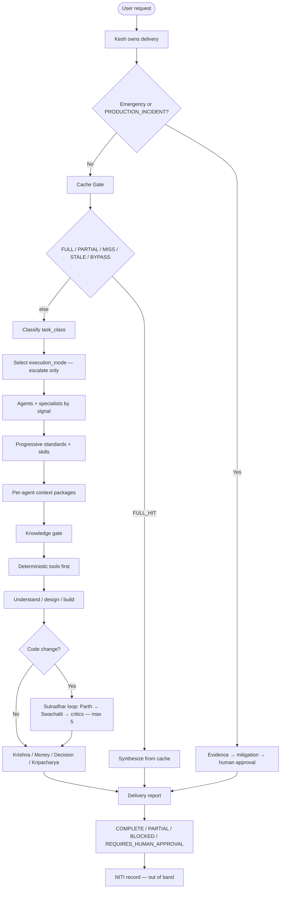

# Kesh Cursor Kit 2.0

Portable **AI engineering operating system** for [Cursor](https://cursor.com): adaptive multi-agent orchestration, modular engineering standards, optional safety hooks, and evidence-based delivery.

Kesh classifies work, delegates only the specialists that add value, implements and reviews production changes, and reports an honest delivery status.

**Repo:** [github.com/udayjadhav/kesh-cursor-mahabharat-agents](https://github.com/udayjadhav/kesh-cursor-mahabharat-agents)

## Quick start

```bash
git clone https://github.com/udayjadhav/kesh-cursor-mahabharat-agents.git
cd kesh-cursor-mahabharat-agents
chmod +x install.sh
./install.sh
# optional:
# INSTALL_KNOWLEDGE=1 INSTALL_HOOKS=1 ./install.sh
./scripts/validate-kit.sh   # kit integrity (from this repo)
```

Restart Cursor, then:

```
@kesh implement feature X
@kesh review this PR
@sanjaya analyze this repository
```

## What is in this repo

| Path | Purpose |
|------|---------|
| `agents/` | 21 subagents (17 roster + 4 support modules) |
| `rules/` | Core always-on contracts + `rules/standards/**` (glob-selective) |
| `knowledge/` | Concept notes + `manifest.json` (optional install) |
| `skills/xray/` | Deep repository analysis skill |
| `skills/knowledge-discovery/` | Tech gap research → propose/update standards |
| `hooks/` | Opt-in destructive-shell safety hooks |
| `scripts/` | `validate-kit.sh` integrity checker |
| `docs/` | Workflow, agents, standards, install |
| `optional/` | Teams template, cache schema notes |
| `install.sh` | Install into `~/.cursor` |

## Documentation map

| Doc | Contents |
|-----|----------|
| [docs/WORKFLOW.md](docs/WORKFLOW.md) | Adaptive task classes, gates, delivery statuses |
| [docs/AGENTS.md](docs/AGENTS.md) | Roster, tiers, models |
| [docs/STANDARDS.md](docs/STANDARDS.md) | Java/Python/React/DB/… modules |
| [docs/KNOWLEDGE.md](docs/KNOWLEDGE.md) | Concept notes + manifest |
| [docs/KNOWLEDGE-DISCOVERY.md](docs/KNOWLEDGE-DISCOVERY.md) | Discovery, reconciliation, MDC generation |
| [rules/kesh-human-communication.mdc](rules/kesh-human-communication.mdc) | Mandatory human-quality / paste-ready communication |
| [rules/kesh-code-quality.mdc](rules/kesh-code-quality.mdc) | Mandatory code quality, comments, contracts, docs |
| [rules/kesh-niti.mdc](rules/kesh-niti.mdc) | NITI learning loop + telemetry contract |
| [docs/kesh-2.0/NITI-AUDIT.md](docs/kesh-2.0/NITI-AUDIT.md) | NITI audit (documented vs executable) |
| [docs/kesh-2.0/TOKEN-OPTIMIZATION.md](docs/kesh-2.0/TOKEN-OPTIMIZATION.md) | Risk modes, context packages, cache, guardrails |
| [docs/kesh-2.0/STAFF-ENGINEER-EDITION.md](docs/kesh-2.0/STAFF-ENGINEER-EDITION.md) | Skills-first specialists + optional healthcare pack |
| [docs/SKILLS.md](docs/SKILLS.md) | Progressive skill catalog |
| [docs/RULES.md](docs/RULES.md) | Core rules reference |
| [docs/INSTALL.md](docs/INSTALL.md) | Install / upgrade / flags |
| [docs/ARCHITECTURE.md](docs/ARCHITECTURE.md) | Layers + enforcement levels A–E |
| [docs/kesh-2.0/](docs/kesh-2.0/) | 2.0 baseline, plan, phase reports |
| [CHANGELOG.md](CHANGELOG.md) | Release notes |

**Canonical contract:** `rules/kesh-agent-spec.mdc` **v2.0.0** — when any file disagrees, the spec wins.

## Adaptive flow (2.6)

Full stage-by-stage map (redo loops, per-class paths, agent catalog): **[docs/WORKFLOW.md](docs/WORKFLOW.md)**.



**Roles:** Parth = implementation · Swachalit = tests · Sutradhar = loop orchestration (do not swap).

Twelve task classes include `EXPLANATION`, `BUG_FIX`, `FEATURE`, `DATABASE_CHANGE`, `SECURITY_CHANGE`, `PRODUCTION_INCIDENT`, `CODE_REVIEW`, and more.

**Delivery status:** `COMPLETE` | `PARTIAL` | `BLOCKED` | `REQUIRES_HUMAN_APPROVAL`  
`COMPLETE` requires verification evidence (no fabricated test results).

**Money Lens** is advisory and must not hard-stop mandatory bug/security/incident work.

## Agent roster (summary)

| Agent | Tier | Model | Role |
|-------|------|-------|------|
| Kesh | A | claude-4-7-opus | Supervisor — delivery status |
| Vidura | A | claude-4-7-opus | Requirements |
| Sanjaya | A | claude-4-6-sonnet | Code / XRay |
| Vyasa | A | claude-4-6-sonnet | Org knowledge |
| Vishwakarma | A | claude-4-7-opus | Architecture + ADR |
| Sarthi | A | claude-4-6-sonnet | Planning |
| Krishna | A | claude-4-7-opus | Strategic gate (KILL stops) |
| Money Lens | A | claude-4-6-sonnet | Business trade-offs (advisory) |
| Decision Engine | A | claude-4-7-opus | GO / CONDITIONAL / NO-GO |
| Kripacharya | A | claude-4-6-sonnet | Final validation |
| Parth | B | composer-2 | Implementation |
| Swachalit | B | composer-2 | Tests + execution evidence |
| Sutradhar | B | composer-2 | Build–critique loop |
| NITI | A | claude-4-6-sonnet | Optimization & evaluation (out of band) |
| Bhishma | C | claude-4-6-sonnet | Code review |
| Lakshman | C | claude-4-6-sonnet | QA |
| Draupadi | C | claude-4-6-sonnet | Customer impact |

**Invariant:** Parth and Bhishma must never share the same model.

## Enforcement honesty

| Level | Meaning |
|-------|---------|
| A | Documented only |
| B | Prompt-guided |
| C | Tool-supported (Cursor globs, subagents, model pins) |
| D | Executably enforced (installer, optional hooks, validator) |
| E | Tested (`tests/validate-kit.test.sh`) |

Most orchestration behavior is **B/C**. Kit structure is validated at **D/E**. Optional hooks raise selected shell risks to **D** when installed.

## Customization checklist

- [ ] `INSTALL_KNOWLEDGE=1` if you want concept notes under `~/.cursor/knowledge/kesh/`
- [ ] `INSTALL_HOOKS=1` and enable `hooks.json` if you want destructive-shell prompts
- [ ] `SKIP_CLOJURE=1` if you do not use Clojure
- [ ] `INSTALL_TEAMS=1` or copy `optional/teams.mdc` for Jira rosters
- [ ] Skim [docs/STANDARDS.md](docs/STANDARDS.md) for your stacks
- [ ] Verify model slugs against your Cursor plan

## License

MIT — see [LICENSE](LICENSE).
