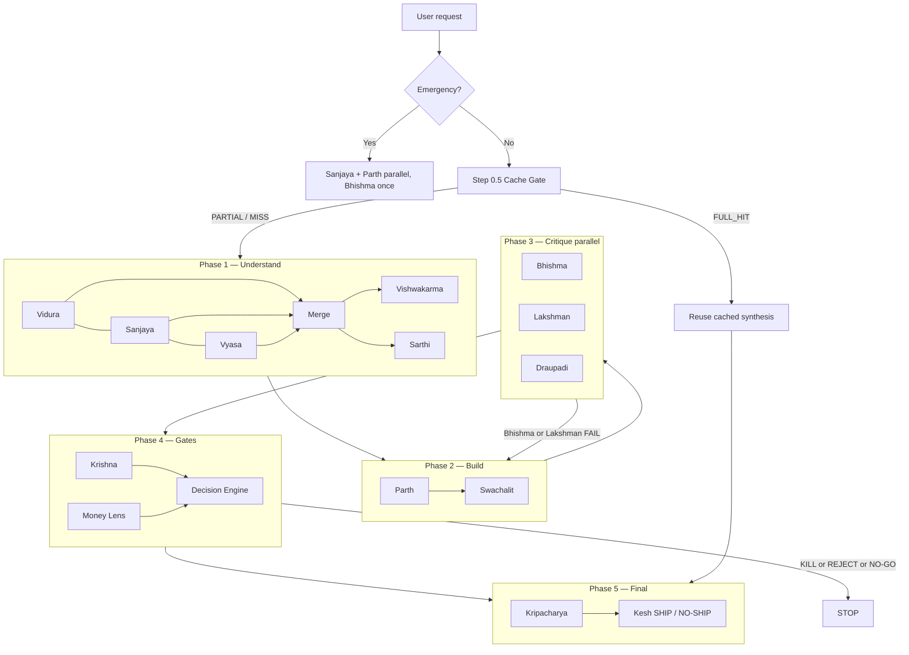

# Kesh Cursor Kit

Portable multi-agent orchestration for [Cursor](https://cursor.com): agents, rules, skills, and documentation you can copy to any machine.

Think of it as a **hospital workflow** — triage (intent), specialists in parallel (code, history, design), a cache check so you do not re-diagnose the same case, build, independent review, business gates, then ship / no-ship.

**Repo:** [github.com/udayjadhav/kesh-cursor-mahabharat-agents](https://github.com/udayjadhav/kesh-cursor-mahabharat-agents)

## Quick start

```bash
git clone https://github.com/udayjadhav/kesh-cursor-mahabharat-agents.git
cd kesh-cursor-mahabharat-agents
chmod +x install.sh
./install.sh
```

Restart Cursor, then in chat:

```
@kesh implement feature X
@kesh review this PR
@sanjaya analyze this repository
```

## What is in this repo

| Path | Purpose |
|------|---------|
| `agents/` | 21 Cursor subagent definitions (17 roster + 4 Kesh support modules) |
| `rules/` | 13 always-on or contextual `.mdc` rules (canonical spec, router, cache, voice) |
| `skills/xray/` | Deep repository analysis skill |
| `docs/` | Human-readable workflow, agent roster, install, rules reference |
| `optional/` | Notes for org-specific customisation (team rosters, Clojure) |
| `install.sh` | One-command install into `~/.cursor` |

## Documentation map

| Doc | Contents |
|-----|----------|
| [docs/WORKFLOW.md](docs/WORKFLOW.md) | Full 15-step flow, cache gate, parallel stages, loop-back, emergency override |
| [docs/AGENTS.md](docs/AGENTS.md) | Every agent: role, tier, model, when to use |
| [docs/RULES.md](docs/RULES.md) | Every rule file and what it enforces |
| [docs/SKILLS.md](docs/SKILLS.md) | Skills (XRay) and how they attach |
| [docs/INSTALL.md](docs/INSTALL.md) | Install, upgrade, per-repo overrides, troubleshooting |
| [docs/ARCHITECTURE.md](docs/ARCHITECTURE.md) | System layers, invariants, global vs local sync |
| [CHANGELOG.md](CHANGELOG.md) | What changed in this kit |

**Canonical contract:** `rules/kesh-agent-spec.mdc` — when any file disagrees, the spec wins.

## 15-step flow (compressed)



Wall-clock: ~5 parallel stages instead of 15 serial steps (~3× faster while using all applicable agents).

## Agent roster (summary)

| Agent | Tier | Model | Role |
|-------|------|-------|------|
| Kesh | A | claude-4-7-opus | Supervisor — SHIP / NO-SHIP |
| Vidura | A | claude-4-7-opus | Requirements |
| Sanjaya | A | claude-4-6-sonnet | Code / XRay |
| Vyasa | A | claude-4-6-sonnet | Org knowledge (5 sources) |
| Vishwakarma | A | claude-4-7-opus | Architecture |
| Sarthi | A | claude-4-6-sonnet | Planning |
| Krishna | A | claude-4-7-opus | Strategic gate (KILL stops) |
| Money Lens | A | claude-4-6-sonnet | Business gate (REJECT stops) |
| Decision Engine | A | claude-4-7-opus | GO / CONDITIONAL / NO-GO |
| Kripacharya | A | claude-4-6-sonnet | Final validation |
| Parth | B | composer-2 | Implementation |
| Swachalit | B | composer-2 | Tests |
| Sutradhar | B | composer-2 | Execution orchestration |
| NITI | B | composer-2 | System optimization |
| Bhishma | C | claude-4-6-sonnet | Code review (FAIL → loop) |
| Lakshman | C | claude-4-6-sonnet | QA (FAIL → loop) |
| Draupadi | C | claude-4-6-sonnet | Customer impact |

Support modules (no pinned model — inherit the parent chat): `kesh-flows`, `kesh-context`, `kesh-output`, `kesh-rules`.

**Invariant:** Parth (`composer-2`) and Bhishma (`claude-4-6-sonnet`) must never share the same model.

See [docs/AGENTS.md](docs/AGENTS.md) for full detail.

## Manual install (no script)

```bash
cp -a agents/*   ~/.cursor/agents/
cp -a rules/*    ~/.cursor/rules/
cp -a skills/xray/* ~/.cursor/skills/xray/
```

## Per-repo overrides

```
my-repo/
└── .cursor/
    ├── agents/bhishma.md   # overrides global for this repo only
    └── rules/              # optional project rules
```

Resolution: **local overrides global** for that repository. See `rules/global-local-sync.mdc`.

## Customization checklist

- [ ] Edit or replace `rules/teams.mdc` with your Jira team rosters (or delete it)
- [ ] Edit `rules/clojure-*.mdc` if you do not use Clojure
- [ ] Configure Vyasa MCP / Atlassian if you use org knowledge harvest
- [ ] Verify model slugs match your Cursor plan ([models docs](https://cursor.com/docs/models-and-pricing))

## License

MIT — see [LICENSE](LICENSE).
