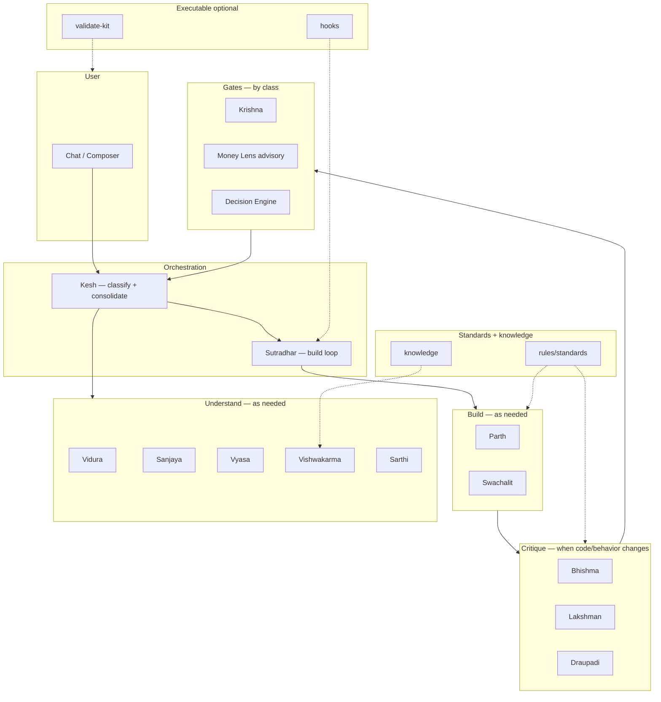

# System Architecture (Kesh 2.0)

## Layers



## Separation of concerns

| Concern | Owner | Must not |
|---------|-------|----------|
| Classification / delivery | Kesh | Mark COMPLETE without verification |
| Requirements | Vidura | Write production code |
| Code map | Sanjaya | Invent org history |
| Org history | Vyasa | Invent code behavior |
| Architecture | Vishwakarma | Implement |
| Plan | Sarthi | Skip Option 0 when schema work |
| Implementation | Parth | Self-approve; fabricate checks |
| Tests | Swachalit | Fabricate results |
| Code quality | Bhishma | Share Parth’s model |
| Behavior QA | Lakshman | — |
| User impact | Draupadi | Block ship alone |
| Strategy | Krishna | Proceed after KILL |
| Business trade-offs | Money Lens | Hard-stop mandatory remediation |
| Synthesis | Decision Engine | ROI-only NO-GO on mandatory fixes |

## Configuration layout

```
~/.cursor/
├── agents/
├── rules/           # includes standards/ after install
├── skills/xray/
├── knowledge/kesh/  # optional INSTALL_KNOWLEDGE=1
└── hooks/           # optional INSTALL_HOOKS=1

<repo>/.cursor/      # local overrides + project hooks.json
```

## Enforcement levels (A–E)

| Level | Examples in this kit |
|-------|----------------------|
| A | Docs, knowledge notes |
| B | Agent prompts, most workflow rules |
| C | `model:` pins, rule `globs`, subagents |
| D | `install.sh`, optional shell hooks, `validate-kit.sh` |
| E | `tests/validate-kit.test.sh` |

Do not claim prompt instructions are executable controls.

## Invariants

1. Thinking / execution / critique separation  
2. Parth model ≠ Bhishma model  
3. Adaptive agent selection (not maximization)  
4. Evidence for tests and scans  
5. Reuse-before-extend on schema association problems  
6. External-output voice scrubbing  

## Versioning

- Spec frontmatter `version: 2.0.0`
- Document breaking changes in `CHANGELOG.md`
- Tag releases `v2.0.0` when publishing
