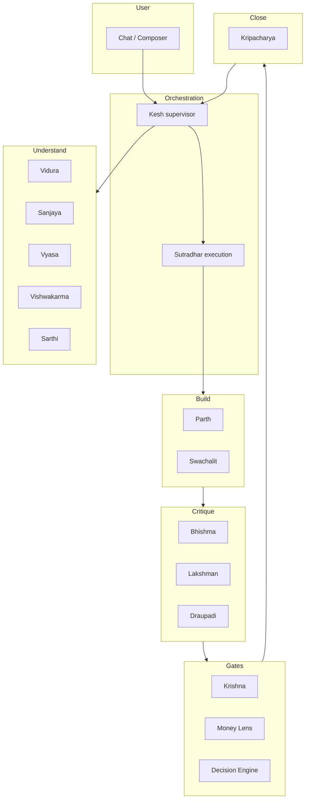

# System Architecture

## Layers



## Separation of concerns

| Concern | Owner | Must not |
|---------|-------|----------|
| What to build | Vidura | Write production code |
| How code is structured | Sanjaya | Speculate org history without citations |
| Why it existed historically | Vyasa | Invent code behavior |
| How to build it | Vishwakarma + Sarthi | Implement |
| Implementation | Parth | Self-approve |
| Tests | Swachalit | Skip on production-bound work |
| Code quality | Bhishma | Use same model as Parth |
| Behavior correctness | Lakshman | Block without FAIL verdict path |
| Customer impact | Draupadi | Block ship alone |
| Worth building | Krishna | Proceed after KILL |
| Business ROI | Money Lens | Proceed after REJECT |
| Synthesis | Decision Engine | Skip tradeoff matrix |
| System ready | Kripacharya | SHIP without Kesh |
| Final authority | Kesh | Execute tasks directly |

## Configuration layout on disk

```
~/.cursor/                          # GLOBAL (this kit installs here)
├── agents/                         # Subagent definitions
├── rules/                          # Always-on / contextual rules
└── skills/                         # SKILL.md procedures

<repository>/.cursor/               # LOCAL (optional overrides)
├── agents/
└── rules/
```

Resolution order: **local repo → global home**.

## Data flow (simplified)

```
User message
  → kesh-always-on + runtime-router (rules)
  → Emergency check
  → Cache Gate (kesh-token-cache) — FULL_HIT / PARTIAL_HIT / MISS
  → Kesh classifies input (kesh-flows)
  → Parallel specialists produce artifacts
  → Sutradhar runs build loop if needed
  → Merged critique → gates → Kripacharya → Kesh verdict
  → kesh-output + explanation-framework format response
```

External artifacts (Confluence, Jira, PR body) pass through `kesh-external-output-voice` scrubbing.

## Reuse-before-extend (cross-cutting)

For routing / lookup / association problems:

1. Sanjaya: **Field Carrier Inventory**
2. Vishwakarma: **Option 0 — Reuse-only** in options matrix
3. Krishna: **Data Model Reuse Audit**
4. Bhishma: **Schema Reuse** check on every new field/collection
5. Consumer audit for external libs (e.g. query DSL in another repo)

See `rules/reuse-before-extend.mdc`.

## NITI (out of band)

NITI analyzes agent performance periodically — not part of the mandatory 15-step delivery path. Invoke on demand or every N tasks for process improvement.

## Versioning this kit

- Bump `rules/kesh-agent-spec.mdc` frontmatter `version` when contract changes
- Tag git releases: `v1.1.0`
- Document breaking changes in repo CHANGELOG if you maintain one
