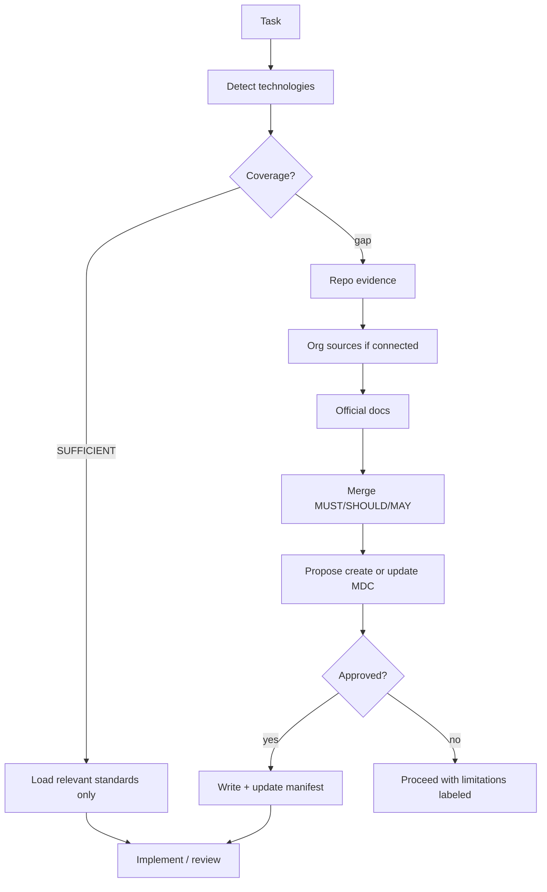

# Knowledge Discovery & Standards Reconciliation

Kesh progressively learns the engineering ecosystem it works in — without a new agent and without MDC spam.

## Ownership

| Step | Owner |
|------|-------|
| Detect tech + coverage | Sanjaya |
| Org docs | Vyasa (or `UNAVAILABLE`) |
| External official docs + merge | Kesh + `skills/knowledge-discovery` |
| Architecture conflicts | Vishwakarma (ADR) |
| Consume standards | Parth / Bhishma / Swachalit / … |
| Write shared MDC | Human approval |

## Flow

## Authority

Org mandatory policy > org platform standards > team ADRs > repo patterns > official vendor docs > credible external > inference.

Never silent-replace org mandates. Escalate org-vs-security conflicts.

## Acceptance scenarios

See [kesh-2.0/KNOWLEDGE-DISCOVERY-ACCEPTANCE.md](./kesh-2.0/KNOWLEDGE-DISCOVERY-ACCEPTANCE.md).
