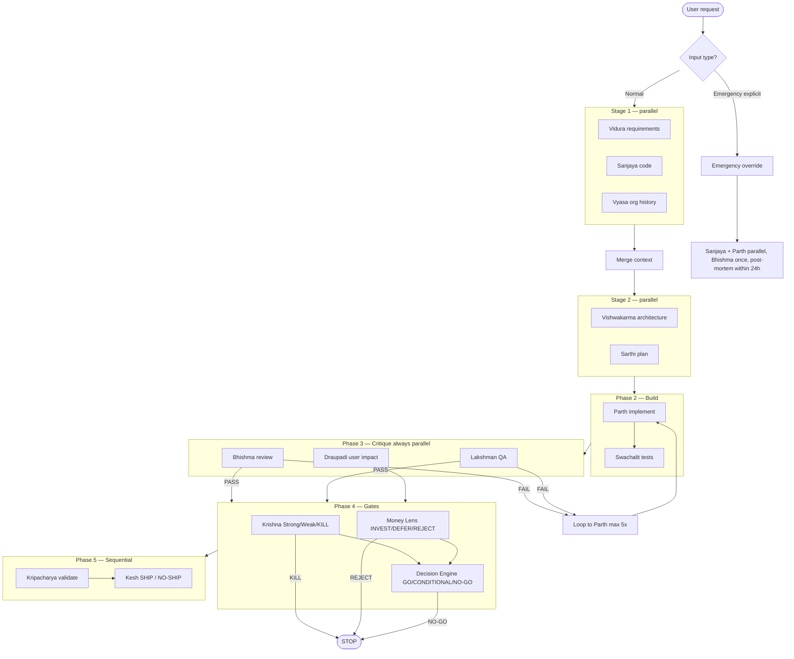

# Kesh Workflow — 15-Step Execution Flow

> **Authority:** `rules/kesh-agent-spec.mdc`. This document is a readable guide; the spec is the contract.

## Real-world analogy

A software task goes through a **hospital**:

| Hospital | Kesh |
|----------|------|
| Triage nurse | Intent classification + Kesh router |
| Specialists (parallel) | Vidura, Sanjaya, Vyasa, Vishwakarma, Sarthi |
| Surgery | Parth + Swachalit |
| Independent second opinions | Bhishma, Lakshman, Draupadi (parallel) |
| Ethics / cost committee | Krishna, Money Lens |
| Chief of medicine | Decision Engine |
| Discharge review | Kripacharya → Kesh SHIP/NO-SHIP |

## Full flow diagram



## Step-by-step table

| Step | Phase | Agent | Tier | Blocks? | On failure |
|------|-------|-------|------|---------|------------|
| 1 | Understand | Vidura | A | No | — |
| 2 | Understand | Sanjaya | A | No | — |
| 3 | Understand | Vyasa | A | No | — |
| 4 | Understand | Vishwakarma | A | No | — |
| 5 | Understand | Sarthi | A | No | — |
| 6 | Build | Parth | B | No | — |
| 7 | Build | Swachalit | B | No | — |
| 8 | Critique | Bhishma | C | **FAIL** | Loop → step 6 |
| 9 | Critique | Lakshman | C | **FAIL** | Loop → step 6 |
| 10 | Critique | Draupadi | C | Advisory | — |
| 11 | Gates | Krishna | A | **KILL** | Full stop |
| 12 | Gates | Money Lens | A | **REJECT** | Full stop |
| 13 | Gates | Decision Engine | A | NO-GO / CONDITIONAL | Stop or conditions |
| 14 | Final | Kripacharya | A | NOT-READY | Address gaps |
| 15 | Final | Kesh | A | NO-SHIP | Do not deliver |

## Parallelization (wall-clock stages)

| Stage | Agents (parallel) | Waits for |
|-------|-------------------|-----------|
| 1 | Vidura ∥ Sanjaya ∥ Vyasa | — |
| 2 | Vishwakarma ∥ Sarthi | Stage 1 merge |
| 3 | Parth (per file) ∥ … | Stage 2 |
| 4 | Swachalit | Parth lane(s) |
| 5 | Bhishma ∥ Lakshman ∥ Draupadi | Build artifact |
| 6 | Krishna ∥ Money Lens | Critique merge |
| 7 | Decision Engine | Both gates |
| 8 | Kripacharya → Kesh | Decision Engine |

## Build–critique loop

```
Parth → Swachalit → Bhishma + Lakshman (parallel)
                         │
                    FAIL ├──→ back to Parth (max 5 iterations)
                         │
                    PASS └──→ Draupadi → Phase 4 gates
```

Iteration 6+ → escalate to Vishwakarma for re-architecture.

## Input types

| Type | Description | Typical skips |
|------|-------------|---------------|
| CODE_INPUT | Repo / files present | None (full flow) |
| PATCH_INPUT | Diff / PR review only | Parth, Swachalit if no build |
| IDEA_INPUT | Vague idea | — |
| DEFINED_INPUT | Clear requirements | Light Vidura |

Skips are **applicability-only**, never cost-based. See spec "Skip Logic".

## Emergency override

Triggered **only** when the user explicitly says: production down, security breach, data loss, customer escalation critical, or "fast mode" / "emergency mode".

- Skip Phase 1 → Sanjaya + Parth in parallel
- Vyasa skipped
- Bhishma once (no loop)
- Mandatory full 15-step post-mortem within 24h

## Phase 4 outputs (what you get)

**Krishna** — assumptions challenged, failure modes, verdict: STRONG / WEAK / KILL

**Money Lens** — scale, revenue, leverage, cost → INVEST / DEFER / REJECT

**Decision Engine** — tradeoff matrix, risk scores (tech/biz/customer/time), **GO / CONDITIONAL / NO-GO**, prioritized next actions

## Kesh modular files

These support the supervisor without replacing the spec:

| File | Purpose |
|------|---------|
| `agents/kesh-flows.md` | Flow control, input classification |
| `agents/kesh-context.md` | Context handoff between agents |
| `agents/kesh-output.md` | Output formatting |
| `agents/kesh-rules.md` | Operational rules index |

## Related rules

- `kesh-runtime-router.mdc` — intent-based routing
- `kesh-always-on.mdc` — route all instructions through Kesh
- `reuse-before-extend.mdc` — Option 0 reuse-only before new schema
- `kesh-external-output-voice.mdc` — scrub agent names for Confluence/Jira/PR
