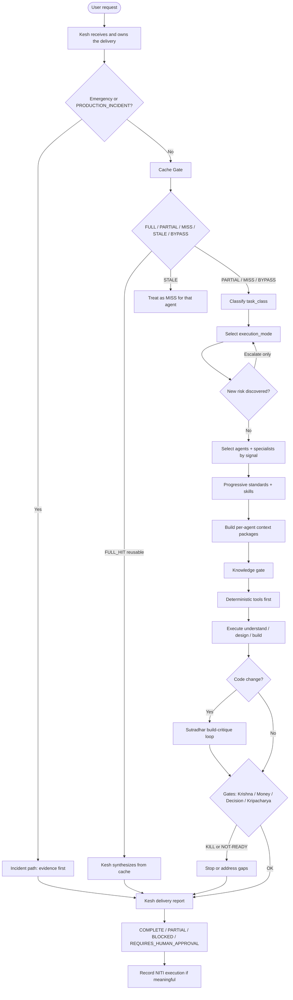
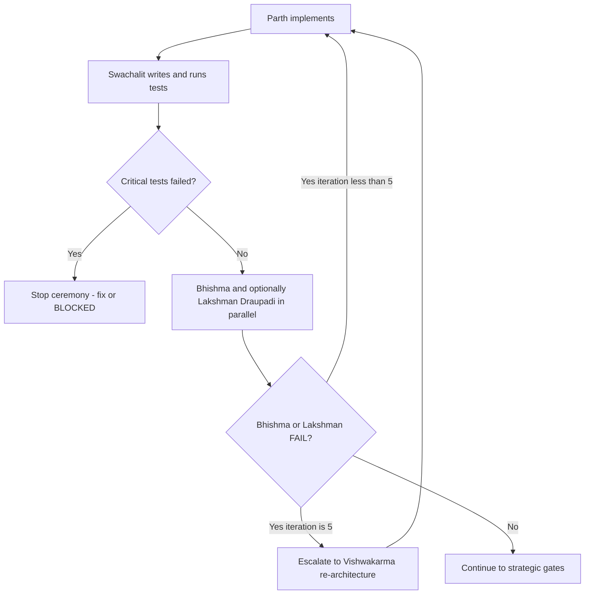

# Kesh Adaptive Workflow 2.6 — Detailed Lifecycle

> **Authority:** [`rules/kesh-agent-spec.mdc`](../rules/kesh-agent-spec.mdc). This page is the human-readable map of how a request moves through Kesh.  
> **Roles (do not swap):** **Parth = implementation**, **Swachalit = tests**, **Sutradhar = build–critique loop orchestration**.

---

## 1. Analogy

A request enters a **clinic**, not a full hospital for every cough — but when the case is serious, the clinic escalates to specialists, surgery, second opinions, and discharge with evidence.

| Clinic | Kesh |
|--------|------|
| Front desk | User → `@kesh` (or Kesh always-on) |
| Triage nurse | `task_class` + risk signals |
| Chart check | Cache Gate |
| Risk band | `execution_mode` (FAST → INCIDENT_ARCHITECTURE) |
| Specialists | Minimum sufficient agents + progressive skills |
| Surgery | Parth (code) → Swachalit (tests) |
| Second opinions | Bhishma / Lakshman / Draupadi (distinct lanes) |
| Ethics / strategy | Krishna, Money Lens (advisory), Decision Engine |
| Discharge | Delivery status + verification evidence |
| After-action | NITI (out of band) |

---

## 2. End-to-end master flow



---

## 3. Stage-by-stage detail

### Stage 0 — Entry

1. User asks in chat (ideally `@kesh …`).
2. **Kesh** owns routing, context, synthesis, and final status.
3. Kesh does **not** implement product code itself; it delegates.

### Stage 1 — Emergency / incident check

Triggers (explicit user language or `task_class = PRODUCTION_INCIDENT`):

- Production down, security breach, data loss, critical escalation, “fast/emergency mode” for incidents.

**Path:**

1. Gather **evidence** (logs, symptoms, blast radius) — Sanjaya as needed.
2. Hypotheses → mitigation **proposal**.
3. **No silent prod mutation.** Consequential acts → `REQUIRES_HUMAN_APPROVAL`.
4. After approval: smallest safe fix → Swachalit regression → Bhishma before `COMPLETE`.
5. Vyasa only if needed for blast radius / prior incidents — do not block diagnosis on org harvest.

### Stage 2 — Cache Gate

See `kesh-token-cache.mdc` / `scripts/cache/*`.

| Result | Action |
|--------|--------|
| FULL_HIT | Reuse agent summaries; skip re-run of those agents |
| PARTIAL_HIT | Reuse fresh; run missing/stale |
| MISS | Full applicable path |
| STALE | **Not** current evidence for tests/security/source conclusions |
| BYPASS | User said ignore/fresh/bypass cache |

Kesh states: `CACHE: FULL_HIT | PARTIAL_HIT | MISS | STALE`.

### Stage 3 — Classify `task_class` (exactly one primary)

| Class | Intent |
|-------|--------|
| EXPLANATION | How/why something works |
| INVESTIGATION | Find where / why without necessarily fixing |
| DEBUGGING | Symptom → root cause → fix |
| PATCH | Small contained change |
| BUG_FIX | Correct defective behavior |
| FEATURE | New capability |
| REFACTOR | Restructure without intended behavior change |
| ARCHITECTURE | Design / ADR / system shape |
| DATABASE_CHANGE | Schema, migration, storage engine work |
| SECURITY_CHANGE | Authn/z, isolation, threat-relevant |
| PRODUCTION_INCIDENT | Live failure response |
| CODE_REVIEW | Review existing diff/PR |

### Stage 4 — Select `execution_mode` (escalate only)

| Mode | Default classes | Meaning |
|------|-----------------|---------|
| FAST | EXPLANATION, light INVESTIGATION | Minimal agents; focused checks |
| STANDARD | PATCH, BUG_FIX, FEATURE, REFACTOR, CODE_REVIEW, DEBUGGING | Build + test + specialized review |
| CRITICAL | DATABASE_CHANGE, SECURITY_CHANGE; + signals api/ai/schema/… | Deeper design + independent validation |
| INCIDENT_ARCHITECTURE | ARCHITECTURE, PRODUCTION_INCIDENT | Full applicable specialists |

**Never downgrade** solely to save tokens. Escalate when security, schema, distributed consistency, AI high-impact, multi-tenant, or prod risk appears.

Helper: `python3 scripts/modes/select_mode.py --task-class FEATURE --signals api,security --with-agents`

### Stage 5 — Select agents (minimum sufficient)

Kesh picks from the class template **intersected** with mode. Optional agents only when their inputs exist and risk warrants them.

**Specialists by signal (Staff Edition):**

| Signal | Agent / skill |
|--------|----------------|
| api, contract, openapi, grpc, graphql | **api-architect** + `skills/api-engineering` |
| ai, llm, prompt, eval | **ai-product-engineer** + `skills/ai-engineering` |
| healthcare, npi, fhir (pack installed) | **healthcare-domain** + healthcare skill |
| database, spanner, kafka, schema | Vishwakarma/Bhishma + `skills/data-engineering` |
| frontend, react | Vishwakarma/Bhishma + `skills/frontend-architecture` |
| workflow, saga, outbox | Vishwakarma + `skills/workflow-architecture` |
| slo, latency, reliability | + `skills/reliability-performance` |

Helpers:

```bash
python3 scripts/skills/select_skills.py --paths '…' --signals '…'
python3 scripts/standards/select_standards.py --paths '…' --signals '…'
```

### Stage 6 — Context packages

Each Task/subagent gets a **slice**, not the whole chat or every rule file.

Shape: requirements, constraints, `source_refs`, `standards_refs`, `skills_refs`, verified findings, expected output, open questions, mode, task_class.

Helper: `python3 scripts/context/package.py`

### Stage 7 — Knowledge gate

1. Technology inventory (Sanjaya / `scripts/repo/profile.py`).
2. Coverage vs `knowledge/manifest.json` + standards.
3. **SUFFICIENT** → load only needed packs.
4. Gap → discover → propose MDC; **human approval** before writing shared standards.
5. Pass `knowledge_pack` once — do not re-research per agent.

### Stage 8 — Deterministic verification first

Before extra LLM ceremony:

```bash
python3 scripts/quality/discover_tools.py --root <repo>
```

Run what exists (compile, unit tests, eslint, tsc, ruff, …).  
Report **MISSING** or **NOT RUN** — never invent PASS.

### Stage 9 — Execute by phase

See Section 5 (agent catalog) and Section 6 (per-class paths).

### Stage 10 — Build–critique loop (Sutradhar)

Only when code/behavior changes:



Rules:

- Max **5** loop iterations, then Vishwakarma.
- Max **3** transient retries per agent.
- Critical security / test failure → do **not** continue for ceremony.
- Fresh context package each iteration + short history summary (no dirty full transcript).

### Stage 11 — Strategic / readiness gates

| Gate | Blocks? | Notes |
|------|---------|-------|
| Krishna KILL | Yes | Full stop |
| Money Lens | Advisory | Must **not** REJECT-stop bug/security/incident/mandatory reliability |
| Decision Engine | Soft/hard by class | ROI alone cannot NO-GO mandatory remediation |
| Kripacharya NOT-READY | Address gaps | Completeness / docs / ops |
| Kesh | Final | Sets delivery status |

### Stage 12 — Delivery report

Kesh emits (see `agents/kesh-output.md`):

- Task summary, files, decisions  
- Documentation/comments notes  
- NITI telemetry recorded?  
- Verification table (command / exit code)  
- Findings (deduplicated)  
- Security residual  
- Risks / unknowns  
- Status: `COMPLETE | PARTIAL | BLOCKED | REQUIRES_HUMAN_APPROVAL`  
- `execution_mode` + `CACHE:` line  

**COMPLETE** requires verification evidence for required checks.

### Stage 13 — NITI (out of band)

Not every task. After meaningful COMPLETE/PARTIAL (and failures):

```bash
python3 scripts/niti/record_execution.py --json '…'
python3 scripts/niti/should_invoke.py
```

Triggers: every 5 / 20 meaningful tasks, post-incident, on-demand, before/after kit change.  
NITI **proposes** only — does not auto-edit the kit.

---

## 4. Who does what (agent catalog)

| Agent | Role in the flow | Typical inputs | Typical outputs | Does **not** |
|-------|------------------|----------------|-----------------|--------------|
| **Kesh** | Router, synthesizer, final status | User request | Delivery report | Write product code |
| **Vidura** | Clarify requirements | Vague ask | Spec + edge cases | Implement |
| **Sanjaya** | Repo x-ray / evidence | Codebase | System map, field inventory | Design options |
| **Vyasa** | Org / docs harvest | Topic | Cited bundle or `no_context` | Speculate on code |
| **Vishwakarma** | Architecture | Spec + xray | Options + Option 0 + ADR | Ship code |
| **Sarthi** | Plan / estimates | Spec + design | Task breakdown | Implement |
| **api-architect** | Contract critique | API proposal | Compatibility + tests needed | Implement |
| **ai-product-engineer** | LLM product critique | AI design | Evals, fallbacks, safety | Treat HTTP 200 as correctness |
| **healthcare-domain** | Domain (optional pack) | Provider data Q | Facts vs assumptions | Invent business rules |
| **Parth** | **Implements code** | Context package | Diff + check commands | Approve own work |
| **Swachalit** | **Writes/runs tests** | Parth output | Tests + exit codes | Product feature design |
| **Sutradhar** | Loop orchestration | Shared knowledge | Iteration state | Replace critics |
| **Bhishma** | Code/security/contracts review | Diff | Issues + PASS/FAIL | Style-only blockers |
| **Lakshman** | Behavior / acceptance QA | Requirements + diff | Use-case PASS/FAIL | Duplicate Bhishma security list |
| **Draupadi** | User/customer impact | Change description | Impact assessment | Block on style |
| **Krishna** | Strategic challenge | Design/plan | STRONG / WEAK / KILL | Implement |
| **Money Lens** | Business trade-offs | Optional feature | Advisory | Hard-stop mandatory fixes |
| **Decision Engine** | Verdict synthesis | Prior outputs | GO / CONDITIONAL / NO-GO | Ignore mandatory remediation |
| **Kripacharya** | Readiness | Full package | READY / NOT-READY | Re-do Bhishma line review |
| **NITI** | Meta optimization | Telemetry | Health report + proposals | Auto-mutate kit |

**Parallel groups (when all are in-scope):**

- Vidura ∥ Sanjaya ∥ Vyasa  
- Vishwakarma ∥ Sarthi  
- Bhishma ∥ Lakshman ∥ Draupadi  
- Krishna ∥ Money Lens  

---

## 5. Per-class paths (detailed)

### EXPLANATION — FAST

```
Kesh → Cache Gate → Sanjaya (± Vyasa if org docs matter)
    → optional skill load for the stack
    → Kesh answer (COMPLETE or PARTIAL)
```

No Parth/Swachalit unless user asks for a code change.

### INVESTIGATION — FAST or escalate

```
Kesh → Sanjaya (± repo profile)
    → if root cause needs design: Vishwakarma
    → Kesh findings
```

Escalate to STANDARD/CRITICAL if a fix or schema/security change is required.

### DEBUGGING — STANDARD

```
Symptom → evidence (Sanjaya)
→ hypotheses → smallest fix (Parth)
→ regression tests (Swachalit)
→ Bhishma (± Lakshman)
→ loop on FAIL (max 5)
→ Kesh status
```

### PATCH / BUG_FIX — STANDARD

```
Light Sanjaya (if needed)
→ Parth → Swachalit → Bhishma
→ Lakshman on BUG_FIX / non-trivial behavior
→ loop FAIL → Parth
→ Kripacharya if claiming COMPLETE
→ Kesh
```

Money Lens must not hard-stop these.

### FEATURE — STANDARD (→ CRITICAL on signals)

```
Vidura (if unclear)
→ Sanjaya ∥ Vyasa (if org footprint)
→ if API surface: api-architect
→ if AI: ai-product-engineer
→ Vishwakarma ∥ Sarthi (skills: data/FE/workflow as matched)
→ Sutradhar: Parth → Swachalit → Bhishma ∥ Lakshman ∥ Draupadi
→ loop…
→ Krishna ∥ Money Lens (advisory)
→ Decision Engine → Kripacharya → Kesh
```

### REFACTOR — STANDARD

```
Sanjaya → Parth → Swachalit → Bhishma ∥ Lakshman
→ Vishwakarma only if structural / boundary change
```

### ARCHITECTURE — INCIDENT_ARCHITECTURE

```
Sanjaya → list ADRs (scripts/adr/list.py)
→ Vishwakarma (Option 0, skills)
→ api-architect / ai-product-engineer if in scope
→ Krishna → Decision Engine
→ ADR draft (scripts/adr/new.py) when lasting decision
→ Kesh (often PARTIAL until implementation ticketed)
```

### DATABASE_CHANGE — CRITICAL

```
Sanjaya → data-engineering skill + engine standards
→ Vishwakarma (migration/expand-contract)
→ Parth → Swachalit → Bhishma ∥ Lakshman
→ discover_tools / migration validate RUN or NOT RUN
→ Kesh (REQUIRES_HUMAN_APPROVAL for destructive DDL)
```

### SECURITY_CHANGE — CRITICAL

```
Threat notes → security-compliance skill
→ Parth → Swachalit → Bhishma (authz/isolation)
→ scanners if AVAILABLE else MISSING
→ Money Lens must not hard-stop
→ Kesh
```

### PRODUCTION_INCIDENT — INCIDENT_ARCHITECTURE

See Stage 1 incident path.

### CODE_REVIEW — STANDARD

```
Bhishma ∥ Lakshman ∥ Draupadi
→ no Parth unless user asks for fixes
→ Kesh consolidates findings
```

---

## 6. Redo / failure matrix

| Event | Immediate action | Cap | Then |
|-------|------------------|-----|------|
| Bhishma FAIL | Sutradhar → Parth again | 5 | Vishwakarma re-arch |
| Lakshman FAIL | Sutradhar → Parth again | 5 | Vishwakarma / clarify Vidura |
| Swachalit critical test fail | Stop build ceremony | — | Fix or `BLOCKED` |
| Tool MISSING | Report MISSING | — | Do not invent PASS |
| Test NOT RUN | Report NOT RUN | — | Cannot claim COMPLETE if required |
| Krishna KILL | Stop | — | Report to user |
| Decision NO-GO (optional work) | Stop or revise | — | Not for mandatory remediation |
| Cache STALE used as “green tests” | Forbidden | — | Re-run verification |
| Human rejects prod action | Stay `REQUIRES_HUMAN_APPROVAL` | — | No silent proceed |
| Ambiguous requirements mid-flight | Vidura | — | Pause implement |
| New security/schema risk | Escalate mode | — | Add specialists/skills |

---

## 7. Mode × depth cheat sheet

| Mode | Understand | Design | Build | Critique | Gates |
|------|------------|--------|-------|----------|-------|
| FAST | Sanjaya light | Skip unless asked | Skip | Skip | Kesh only |
| STANDARD | As needed | If FEATURE/structural | Parth+Swachalit | Bhishma (+Lakshman/Draupadi) | Light / as warranted |
| CRITICAL | Sanjaya + skills | Vishwakarma + specialists | Full | Independent review required | Krishna/DE/Krip as warranted |
| INCIDENT_ARCHITECTURE | Evidence-heavy | Full applicable | Only after approval if prod | Required before COMPLETE | Strict approval |

---

## 8. Context & token rules (always)

1. Progressive skills/standards — never dump the catalog.  
2. Per-agent context packages — file refs over dumps.  
3. Deterministic tools before LLM loops.  
4. Specialized reviewers — no triplicate style nits.  
5. Never sacrifice correctness, security, tests, or high-risk independent review for tokens (`kesh-quality-guardrails.mdc`).

---

## 9. Delivery statuses (final vocabulary)

| Status | Meaning |
|--------|---------|
| COMPLETE | Done + required verification evidence |
| PARTIAL | Useful progress; gaps listed |
| BLOCKED | Needs external input/fix |
| REQUIRES_HUMAN_APPROVAL | Prod, destructive DB, secrets, merge/deploy |

---

## 10. Worked example — FEATURE with API + DB signals

1. User: “Add REST endpoint to enroll provider; store in Spanner.”  
2. Kesh: `task_class=FEATURE`, signals `api,schema,spanner` → mode **CRITICAL**.  
3. Cache MISS.  
4. Vidura clarifies enrollment fields / idempotency.  
5. Sanjaya maps existing enrollment/API/Spanner code; repo profile.  
6. **api-architect** reviews contract (breaking risk, errors, authz).  
7. Vishwakarma + **data-engineering** skill: Option 0, schema, indexes (Spanner ≠ Postgres).  
8. Sarthi plans tasks.  
9. discover_tools → run existing tests baseline.  
10. Sutradhar: Parth implements → Swachalit tests → Bhishma ∥ Lakshman ∥ Draupadi.  
11. Bhishma FAIL (missing tenant check) → Parth fix → Swachalit → Bhishma PASS.  
12. Krishna WEAK on dual-write → address or accept risk.  
13. Decision Engine CONDITIONAL (migration expand-contract first).  
14. Kripacharya READY with conditions.  
15. Kesh: `PARTIAL` or `REQUIRES_HUMAN_APPROVAL` if DDL needs approval; verification table filled.  
16. NITI record_execution with mode CRITICAL, agents, context_chars proxy.

---

## 11. Related files

| Concern | Path |
|---------|------|
| Spec | `rules/kesh-agent-spec.mdc` |
| Router | `rules/kesh-runtime-router.mdc` |
| Modes | `rules/kesh-execution-modes.mdc` |
| Cache | `rules/kesh-token-cache.mdc` |
| Context | `rules/kesh-context-packaging.mdc` |
| Guardrails | `rules/kesh-quality-guardrails.mdc` |
| NITI | `rules/kesh-niti.mdc` |
| Agents | `docs/AGENTS.md` |
| Skills | `docs/SKILLS.md` |
| Staff edition | `docs/kesh-2.0/STAFF-ENGINEER-EDITION.md` |
| Flow support module | `agents/kesh-flows.md` |
