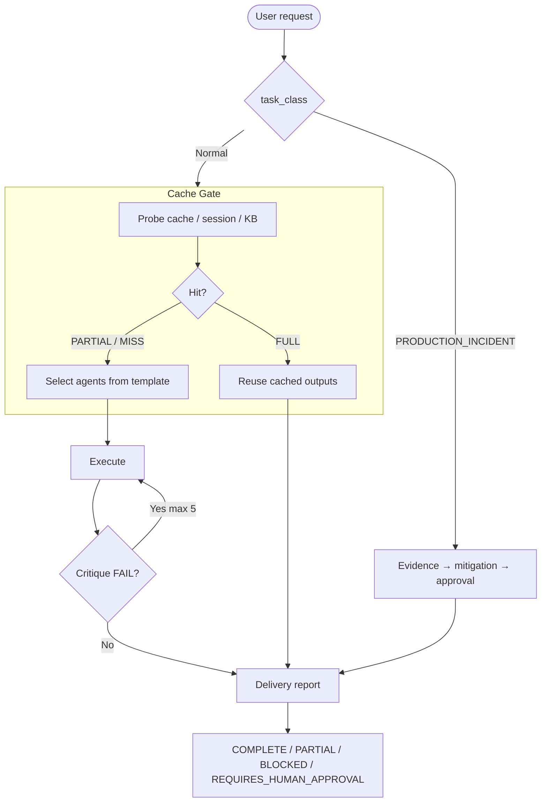

# Kesh Workflow 2.0 — Adaptive Execution

> **Authority:** `rules/kesh-agent-spec.mdc` v2. This document is a readable guide; the spec is the contract.

## Analogy

A software request goes through a **clinic**, not a full hospital for every cough:

| Clinic | Kesh |
|--------|------|
| Triage | Task classification (12 classes) |
| Chart check | Cache Gate |
| Right specialists | Minimum sufficient agents |
| Surgery | Parth + Swachalit when building |
| Second opinion | Bhishma (± Lakshman / Draupadi) |
| Ethics / cost (optional) | Krishna / Money Lens (advisory on remediation) |
| Discharge | Delivery status with evidence |

## Flow

## Task classes

| Class | Typical path |
|-------|----------------|
| EXPLANATION | Sanjaya and/or Vyasa → Kesh |
| INVESTIGATION | Sanjaya (± Vyasa) |
| DEBUGGING | Symptom → evidence → fix → regression → Bhishma |
| PATCH / BUG_FIX | Light understand → Parth → Swachalit → Bhishma (± Lakshman) |
| FEATURE | Vidura → Sanjaya → design/plan → build → critique → gates → close |
| REFACTOR | Sanjaya → Parth → tests → critique |
| ARCHITECTURE | Vishwakarma (+ADR) → Krishna → Decision Engine |
| DATABASE_CHANGE | DB standards → design → migrate carefully → tests → review |
| SECURITY_CHANGE | Threat-aware implement → tests → Bhishma (± scanners) |
| PRODUCTION_INCIDENT | Evidence first; no silent prod mutation |
| CODE_REVIEW | Bhishma ∥ Lakshman ∥ Draupadi |

Full templates: `rules/kesh-agent-spec.mdc`.

## Gates

| Gate | Effect |
|------|--------|
| Bhishma / Lakshman FAIL | Loop to Parth (max 5) |
| Krishna KILL | Stop |
| Money Lens | Advisory — **no REJECT-stop** on mandatory remediation |
| Critical tests / security | Do not continue toward COMPLETE |
| Decision Engine | GO / CONDITIONAL / NO-GO (ROI alone cannot NO-GO mandatory fixes) |

## Delivery statuses

| Status | Meaning |
|--------|---------|
| COMPLETE | Done + required verification evidence |
| PARTIAL | Progress with gaps |
| BLOCKED | Needs external input |
| REQUIRES_HUMAN_APPROVAL | Prod / destructive DB / secrets / merge-deploy |

## Standards

Glob-selective modules under `rules/standards/**` — see [STANDARDS.md](./STANDARDS.md).

## Emergency / incident

Explicit incident language or class `PRODUCTION_INCIDENT`: prioritize diagnosis and safe mitigation; human approval for consequential actions.

## Execution modes (token-aware)

Select `execution_mode` after `task_class`: FAST / STANDARD / CRITICAL / INCIDENT_ARCHITECTURE. Escalate on risk; never downgrade for cost. Package context per agent; load standards progressively; run deterministic checks before extra LLM loops. See `kesh-execution-modes.mdc` and `docs/kesh-2.0/TOKEN-OPTIMIZATION.md`.

## NITI (learning loop — out of band)

Not part of every delivery. After meaningful work, record an execution (`scripts/niti/record_execution.py`). When counters hit 5 or 20 (persisted in `~/.cursor/niti/state.json`), or on failure / demand / kit before-after, run NITI for a human health report. Optional hooks can capture subagent events and nudge via `stop` `followup_message` — **not** cron. See `rules/kesh-niti.mdc` and `docs/kesh-2.0/NITI-AUDIT.md`.

## Related

- `kesh-runtime-router.mdc` — classification
- `kesh-token-cache.mdc` — Cache Gate
- `kesh-output.md` — report template
- `kesh-niti.mdc` — telemetry + NITI triggers
- `hooks/` — optional executable shell gates + NITI telemetry templates
