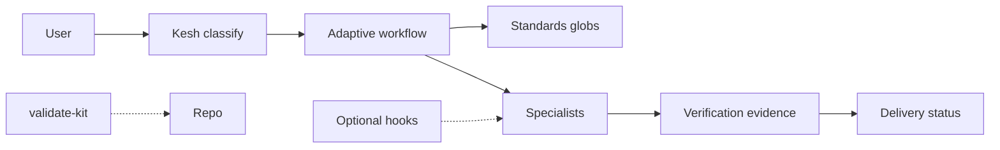

# Kesh 2.0 — Final Audit

**Branch:** `feature/kesh-2.0-rearchitecture`  
**Spec version:** `rules/kesh-agent-spec.mdc` **2.0.0**  
**Date:** 2026-11-22

## Mission outcome

Evolved the portable Cursor kit from a maximization-oriented multi-agent prompt pack into a **modular, evidence-aware AI engineering OS** — without a greenfield rewrite or agent sprawl.

## What shipped on this branch

| Phase | Outcome |
|-------|---------|
| 1 | Baseline with A–E enforcement honesty |
| 2 | Adaptive architecture + file plan; locked decisions |
| 3 | Standards + knowledge + Clojure/teams relocation |
| 4 | Adaptive orchestration; Money Lens advisory; agent upgrades |
| 5 | `validate-kit` + optional destructive-shell hooks (**D/E**) |
| 6 | Installer flags + docs/CHANGELOG 2.0 |
| 7 | Acceptance report; scenarios A–J tabletop only |

## Architecture (after)

## Capability enforcement map (summary)

| Capability | Level |
|------------|-------|
| Adaptive classification & agent prompts | B |
| Model pins / subagents / rule globs | C |
| Installer + nested standards copy | D |
| Optional shell safety hooks | D (opt-in) |
| Kit validator + hook tests | D/E |
| Live multi-agent excellence on real apps | B (unverified by A–J runs) |

## Locked decisions — status

| # | Decision | Done |
|---|----------|------|
| 1 | Money Lens no ROI hard-stop on mandatory remediation | Yes |
| 2 | Knowledge optional → `~/.cursor/knowledge/kesh/` | Yes (`INSTALL_KNOWLEDGE=1`) |
| 3 | Clojure under `rules/standards/` | Yes |
| 4 | teams → optional | Yes |
| 5 | SHIP/COMPLETE only with verification | Yes (contract + output template) |

## Preserved

- Kesh as supervisor  
- Critique independence (Parth ≠ Bhishma)  
- Option 0 / reuse-before-extend  
- External-output voice  
- Portable MIT kit, company-agnostic  

## Explicit non-claims

- Does **not** auto-deploy, auto-merge, or mutate production  
- Does **not** replace security scanners or CI  
- Does **not** guarantee agents always obey prompts  
- Scenario battery A–J **not** live-executed  

## Recommended next actions (operator)

1. Review branch diff; request commit/PR when ready  
2. `./install.sh` (optionally with knowledge/hooks) on a spare profile first  
3. Run live scenarios A–J against real Java/Python/React/DB repos; update Phase 7 table from NOT_EXECUTED → PASS/FAIL  
4. Enable project-level hooks where teams want destructive-shell prompts  
5. Tag `v2.0.0` after merge  

## Final status

**Kit / docs / installer / validator:** COMPLETE  
**Live engineering scenario proof:** PARTIAL (outstanding)  
**Branch merge recommendation:** CONDITIONAL — mergeable as 2.0 kit upgrade after human review; treat live OS claims as pending scenario bake.
