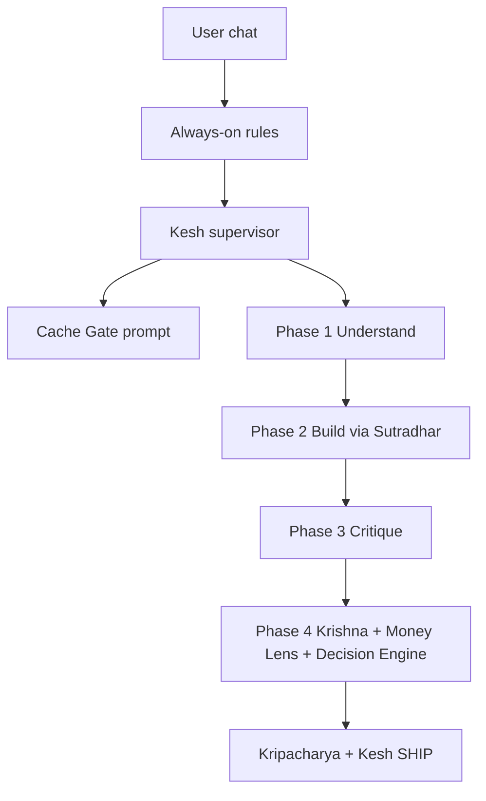

# Kesh 2.0 — Phase 1 Baseline Report

**Branch:** `feature/kesh-2.0-rearchitecture`  
**Repo:** `kesh-cursor-mahabharat-agents` @ synced `main` (pre-change audit)  
**Date:** 2026-11-22  
**Scope:** Prompt-kit / Cursor subagent OS — not an application runtime

**Enforcement levels used throughout:**

| Level | Meaning |
|-------|---------|
| **A** | Documented only (README/docs; not loaded as agent/rule) |
| **B** | Prompt-guided (agent `.md` / rule `.mdc` text the model may follow) |
| **C** | Tool-supported (Cursor features: Task/subagents, `model:` frontmatter, `globs`, MCP) |
| **D** | Executably enforced (hooks, scripts, CI, installers that gate behavior) |
| **E** | Tested and verified (automated tests assert the behavior) |

---

## 1. Executive summary

Kesh today is a **portable Cursor kit**: Markdown agent contracts + always-on rules + one skill + a copy installer. It describes a rigorous 15-step multi-agent hospital workflow with model-tier separation and independent critique.

**What is actually real at runtime:** Cursor loads agents and rules; pinned `model:` fields influence subagent routing (**C**); Clojure rules can selectively load via `globs` (**C**). Almost everything else — mandatory 15 steps, Money Lens REJECT halt, Sutradhar timeouts, Cache Gate, parallel execution claims, SHIP gates — is **prompt-guided (B)** or **documented (A)**. There is **no CI, no hooks in-repo, no test suite for the kit, and no language standards beyond Clojure**.

**Biggest structural risks for Kesh 2.0 goals:**

1. **Agent Maximization** conflicts with adaptive, cost-efficient workflows.
2. **Money Lens REJECT** can block mandatory bugfix / security / incident work.
3. **No engineering standards** for Java/Quarkus, Python, React/TS, databases, microservices, security, testing.
4. **Enforcement theater** — timeouts, cache writes, “tests passed” are not machine-checked.
5. **Language skew** — 950-line Clojure review rule vs zero for primary target stacks.

---

## 2. Repository structure

```
kesh-cursor-mahabharat-agents/
├── agents/          21 × .md (17 roster + 4 support modules)
├── rules/           13 × .mdc
├── skills/xray/     SKILL.md + scoring-guide.md
├── docs/            ARCHITECTURE, WORKFLOW, AGENTS, RULES, INSTALL, SKILLS
├── optional/        README (org customization notes)
├── install.sh       copy agents/rules/skills → ~/.cursor
├── README.md, CHANGELOG.md, LICENSE, .gitignore
```

| Artifact class | Count | Notes |
|----------------|-------|-------|
| Roster agents (pinned model) | 17 | Tier A/B/C |
| Support modules (no model) | 4 | kesh-flows, context, output, rules |
| Always-on rules | ~9 | Spec, router, always-on, cache, voice, sync, … |
| Glob-scoped rules | 2 (+ scoping) | Clojure only for language |
| Executable tooling in kit | 1 | `install.sh` |
| Hooks / CI / kit tests | 0 | None in repo |
| Knowledge/cache schema | Not shipped | Referenced as `~/.cursor/knowledge/cache/` |

**Classification of the product:** Cursor configuration kit / agent OS (**devtools**). Languages: Markdown + Bash. No application code.

---

## 3. Existing architecture



| Layer | Components | Enforcement |
|-------|------------|-------------|
| Orchestration | Kesh, Sutradhar, kesh-flows | **B** (+ Task tool **C** if parent invokes subagents) |
| Understand | Vidura, Sanjaya, Vyasa, Vishwakarma, Sarthi | **B** / Sanjaya+xray skill **B+C** |
| Build | Parth, Swachalit | **B** |
| Critique | Bhishma, Lakshman, Draupadi | **B** (+ model pin **C**) |
| Gates | Krishna, Money Lens, Decision Engine | **B** |
| Close | Kripacharya, Kesh | **B** |
| Meta | NITI | **B** (out of band) |
| Install | `install.sh` | **D** (file copy only) |

**Invariant that is platform-supported:** Parth `composer-2` ≠ Bhishma `claude-4-6-sonnet` via frontmatter (**C**), with Cursor plan/Max Mode fallback possible (**documented limitation**).

---

## 4. Agent responsibilities

| Agent | Role | Unique duty | Shared / overlap |
|-------|------|-------------|------------------|
| Kesh | Supervisor, SHIP/NO-SHIP | Final authority; must not implement | Overlaps Decision Engine on “worth it?” |
| Sutradhar | Build–critique loop | Iteration budget, timeouts (claimed) | Overlaps Kesh orchestration |
| Vidura | Requirements | Spec + edge cases | Overlaps Sarthi on scope |
| Sanjaya | Repo XRay | System map | Overlaps xray skill |
| Vyasa | Org knowledge harvest | Atlassian/helpcenter/status | Optional; often `no_context` |
| Vishwakarma | Architecture | Option 0 reuse matrix | Overlaps Krishna reuse audit |
| Sarthi | Task plan + estimates | Day estimates | Overlaps Vidura |
| Parth | Implementation | Code only | Contradicts self on “add tests” |
| Swachalit | Tests | Write + report results | Does not require real execution |
| Bhishma | Code review | Issues-only, severity, FAIL blocks | Overlaps Lakshman / security |
| Lakshman | QA use cases | Behavior PASS/FAIL | Overlaps Bhishma |
| Draupadi | User impact | Advisory | — |
| Krishna | Strategic gate | STRONG/WEAK/KILL | Overlaps Money Lens / Decision Engine |
| Money Lens | Business ROI | INVEST/DEFER/REJECT with fixed % | **Can stop mandatory work** |
| Decision Engine | Synthesis | GO/CONDITIONAL/NO-GO | Overlaps Kesh |
| Kripacharya | Production readiness | NOT-READY/READY | Overlaps Bhishma/Lakshman |
| NITI | Process optimizer | Out of band | — |
| Support modules | Flow/context/output/rules index | Reference text | Duplicate large chunks of spec |

---

## 5. Existing execution flow

**Documented path (A/B):** Emergency → Cache Gate 0.5 → Intent → 15 steps with parallel stages → SHIP.

**Input types today:** `CODE_INPUT`, `PATCH_INPUT`, `IDEA_INPUT`, `DEFINED_INPUT`, `CACHE_*`.  
**Missing vs Kesh 2.0:** EXPLANATION, INVESTIGATION, DEBUGGING, PATCH, BUG_FIX, FEATURE, REFACTOR, ARCHITECTURE, DATABASE_CHANGE, SECURITY_CHANGE, PRODUCTION_INCIDENT, CODE_REVIEW as first-class classifications.

**Default posture:** Agent Maximization — full flow unless applicability skip (`kesh-agent-spec.mdc`). Conflicts with adaptive workflows in the 2.0 brief.

**Emergency override:** Explicit user phrases only; Sanjaya ∥ Parth, Bhishma once — still **B**.

---

## 6. Existing engineering standards

| Area | Present? | Mechanism | Level |
|------|----------|-----------|-------|
| Clojure style/review | Yes | `clojure-review.mdc`, `clojure-daily-tips.mdc` + globs | **B+C** |
| Java / Quarkus | No | — | — |
| Python | No | — | — |
| React / TypeScript | No | — | — |
| Database design / engines | No | — | — |
| Microservices / distributed systems | No | Fragmented in agent prose | **A/B** weak |
| Security (OWASP, scanners) | Partial | Bhishma severity examples | **B** only |
| Testing standards | Partial | Swachalit guidelines | **B** |
| Software architecture | Partial | Vishwakarma + reuse-before-extend | **B** |
| Dev-spec voice / scoping | Yes | org-process oriented | **B** |
| Team rosters | Template | `teams.mdc` alwaysApply | **B** |
| External output voice | Yes | scrub agent names | **B** (broken frontmatter — see contradictions) |

---

## 7. Automation capabilities

| Capability | Status | Level |
|------------|--------|-------|
| Install/upgrade copy to `~/.cursor` | `install.sh` | **D** |
| Selective standards install | Not supported (full dir copy) | — |
| Cursor hooks (shell gates, subagent) | Not in kit | — (platform supports **D**) |
| Cache Gate file I/O | Prompted; live user may have `~/.cursor/knowledge/cache` | **B** (schema not in kit) |
| NITI logger | Outside kit (`~/.cursor/knowledge/…`) | Not audited as kit artifact |
| CI / GitHub Actions | Absent | — |
| Kit self-tests (frontmatter, refs) | Absent | — |
| Security scanners | Absent | — |
| Forced test execution | Absent | — |

---

## 8. Quality gates (as specified vs enforced)

| Gate | Spec claim | Level | Risk |
|------|------------|-------|------|
| Bhishma FAIL → loop Parth | Yes | **B** | May be ignored by parent agent |
| Lakshman FAIL → loop | Yes | **B** | Same |
| Krishna KILL → STOP | Yes | **B** | Same |
| Money Lens REJECT → STOP | Yes | **B** | Blocks bugfix/security if followed literally |
| Decision Engine NO-GO | Yes | **B** | Same |
| Max 5 build–critique loops | Yes | **B** | Sutradhar timeouts not platform-enforceable |
| Parth ≠ Bhishma model | Yes | **C** | Best real invariant |
| SHIP requires verification | Implied | **B** | Agents may claim SHIP without tests |
| No auto-deploy / no destructive DB | Not kit-enforced | — | Needed in 2.0 |

---

## 9. Capability matrix (A–E)

| Capability | Level | Evidence |
|------------|-------|----------|
| Load agents into Cursor | **C** | `~/.cursor/agents/*.md` + Task |
| Pin subagent models | **C** | YAML `model:` |
| Always-on orchestration prompts | **B** | `alwaysApply: true` rules |
| Glob-selective language rules | **C** | Clojure `globs` |
| Mandatory 15-step execution | **B** | Spec text; not gated by hooks |
| Adaptive task classification (12 types) | Missing | Only coarse input types |
| Parallel agent execution | **B** claim / **C** if Task parallel used | Not verified (**E** absent) |
| Agent timeouts | **A/B** | Sutradhar tables; Cursor does not enforce those limits |
| Cache Gate | **B** | Prompt + optional local files |
| ROI reject gate | **B** | Fixed 50%/100% thresholds in `money-lens.md` |
| Independent code review framework | **B** | Strong Bhishma prompt |
| Test generation | **B** | Swachalit |
| Test execution evidence | **B** (optional) | No requirement that commands ran |
| Security scanning | Missing | Manual LLM only |
| Java/Python/React/DB standards | Missing | — |
| DDIA-style knowledge modules | Missing | — |
| Installer | **D** | `install.sh` |
| Kit verification tests | Missing | No **E** |

---

## 10. Missing capabilities (vs Kesh 2.0 objectives)

1. Adaptive workflows by task class (not maximization-by-default).
2. Modular engineering standards for target stacks + database engine tree.
3. Engineering knowledge framework (replication, consistency, etc.) without copyrighted copy.
4. Parth workflow: inspect → reuse → implement → run checks → honest report.
5. Swachalit: mandatory execution evidence; never fabricate results.
6. Bhishma: confirmed vs needs-verification; reproducible scenarios.
7. Vishwakarma: ADR output; modular monolith vs microservices; trade-off discipline.
8. Debugging / RCA workflow as first-class path.
9. Security integrated with tools where available.
10. Executable safety hooks (destructive shell, secrets, merge/deploy).
11. Sutradhar: real state model; stop on critical test/security failure.
12. Consolidated delivery report (COMPLETE/PARTIAL/BLOCKED/REQUIRES HUMAN APPROVAL).
13. Money Lens contextual trade-offs; **must not block** mandatory remediation.
14. Installer support for nested `standards/` and optional hooks.
15. Acceptance scenarios A–J with honest pass/fail (executed, not theorized).

---

## 11. Contradictions

| ID | Conflict | Evidence |
|----|----------|----------|
| C1 | Maximization vs adaptive routing | Spec “default full 15” vs router “select by intent” vs 2.0 brief |
| C2 | Money Lens REJECT vs mandatory fixes | Spec step 12 STOP; money-lens ROI &lt; 50% REJECT; no exemption for bugs/security/incidents |
| C3 | Parth “code only / tests by Swachalit” vs “Add tests” in process | `parth.md` When Invoked vs Implementation Process step 3 |
| C4 | Parth/Swachalit “When delegated by CEO” | Stale naming; supervisor is Kesh |
| C5 | Kesh “does not perform tasks” vs always-on requiring Task(kesh) from parent | Recursive orchestration risk; parent often implements anyway |
| C6 | `kesh-external-output-voice.mdc` lacks YAML frontmatter | May not load as Cursor rule reliably |
| C7 | `teams.mdc` `alwaysApply: true` with empty template | Noise for public/generic use |
| C8 | Vishwakarma I/O says `plan` from Sarthi required, but Stage 2 runs Vishwakarma ∥ Sarthi | Spec parallelization vs agent contract |
| C9 | Cache Gate references `knowledge/cache/README.md` schema | Not shipped in this repo |
| C10 | Docs say “dynamic selection”; spec says never skip for small tasks | WORKFLOW/router vs agent-spec |

---

## 12. Technical debt

- ~10.5k lines of largely duplicated orchestration prose across spec, router, always-on, kesh.md, kesh-flows.
- Clojure-first standards in a kit positioned as company-agnostic / multi-stack.
- Support modules registered as agents (appear in agent picker) without models.
- No versioned upgrade path beyond overwrite + backup dirs.
- No link checker / frontmatter validator.
- Stale “CEO” vocabulary.
- Explanation framework forces analogy/diagram even for surgical patches (productivity tax).

---

## 13. Risks introduced by the proposed Kesh 2.0 changes

| Risk | Mitigation |
|------|------------|
| Expanding standards without selective load → context bloat | Use `globs` / path-based `alwaysApply: false`; installer optional packs |
| Weakening gates while adding autonomy → unsafe SHIP | Safety hooks + explicit delivery statuses; never SHIP without verification |
| Removing Money Lens block incorrectly → no business scrutiny | Keep advisory trade-off analysis; hard-block only for optional product work |
| Adding many DB engine files → noise | Nested `standards/database/engines/*` with globs; load on file type / path |
| Claiming executable enforcement without hooks | Honest A–E labels; implement only supported Cursor hooks |
| Breaking existing installs | Feature branch; backup install; changelog; migrate Maximization → Adaptive |
| Copyright in knowledge modules | Original summaries; cite concepts, do not copy DDIA text |
| Model slug drift | Keep fallback docs; verify against live Cursor catalog at release |

---

## 14. What must be preserved

- Kesh as central supervisor.
- Separation of thinking / execution / critique.
- No self-approval; Parth ≠ Bhishma model invariant.
- Bhishma issues-only, severity-labeled review culture.
- Option 0 / reuse-before-extend for schema work.
- External-output voice scrubbing.
- Portable install to `~/.cursor` with backups.
- Vyasa optional `no_context` non-blocking behavior.
- XRay skill for Sanjaya.
- Emergency path for true incidents (refine, do not delete).

---

## 15. Audit limitations

- Did not execute live multi-agent runs for scenarios A–J (deferred to Phase 7).
- Did not verify Cursor’s current model catalog slug availability on this account.
- User-local `~/.cursor/knowledge/cache` exists on this machine but is **not** part of the public kit.
- Subagent audit helpers hit model usage limits; primary audit performed by direct file inspection.
