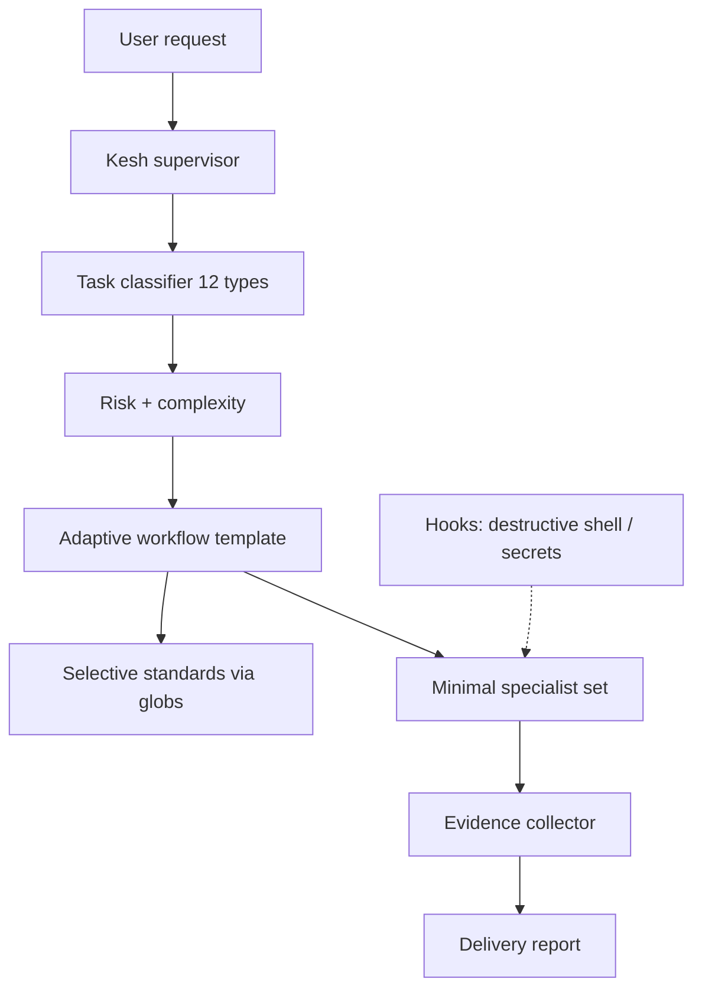

# Kesh 2.0 — Phase 2 Architecture & File-Level Change Plan

**Prerequisite:** [PHASE-1-BASELINE.md](./PHASE-1-BASELINE.md)  
**Branch:** `feature/kesh-2.0-rearchitecture`  
**Constraint:** Upgrade, not greenfield rewrite. No commit/push without approval. No direct `main` edits.

---

## 1. Target architecture (conceptual)



**Principles**

1. **Adaptive by default** — invoke specialists only when they add independent value.
2. **Evidence over narrative** — commands, exit codes, diffs; no fabricated tests/scans.
3. **Standards as modules** — discoverable, glob-selective; not always-on dumps.
4. **Honest enforcement labels** — A–E in docs; never claim D/E without hooks/tests.
5. **Safety over autonomy** — human approval for production/destructive/secret/external exfil/merge.
6. **Preserve roster value** — improve agents in place; do not add agents for headcount.

---

## 2. Orchestration redesign

### 2.1 Replace Agent Maximization with Adaptive Applicability

**File:** `rules/kesh-agent-spec.mdc` (version → `2.0.0`)

- Remove “default to every applicable agent / full 15 for non-trivial”.
- Add **Task Classification** (12 types from brief).
- Add **Workflow templates** mapping class → required / optional / skipped agents.
- Keep hard invariants: no self-approval; Parth ≠ Bhishma model; critique independence.
- **Money Lens:** contextual trade-off analysis; **cannot REJECT-stop** BUG_FIX, SECURITY_CHANGE, PRODUCTION_INCIDENT, mandatory reliability remediations. For FEATURE/ARCHITECTURE optional work, remain advisory or soft-gate via Decision Engine — not arbitrary ROI %.
- Delivery statuses: `COMPLETE | PARTIAL | BLOCKED | REQUIRES_HUMAN_APPROVAL` (retire sole reliance on SHIP when verification incomplete).

### 2.2 Task class → workflow (summary)

| Class | Typical agents | Standards | Gates |
|-------|----------------|-----------|-------|
| EXPLANATION | Sanjaya and/or Vyasa as needed; Kesh synthesizes | Loaded by topic | No Money Lens block |
| INVESTIGATION | Sanjaya, optional Vyasa, Kesh | Stack globs | — |
| DEBUGGING | RCA workflow: Sanjaya → hypotheses → Parth fix → Swachalit regression → Bhishma | Stack | Skip ROI reject |
| PATCH / BUG_FIX | Light Vidura if unclear; Sanjaya; Parth; Swachalit; Bhishma; Lakshman | Stack | No ROI reject |
| FEATURE | Vidura; Sanjaya; Vishwakarma; Sarthi; Parth; Swachalit; critique trio; Krishna; Money Lens advisory; Decision Engine; Kripacharya; Kesh | Stack + arch | Soft business gate |
| REFACTOR | Sanjaya; Vishwakarma if structural; Parth; Swachalit; Bhishma; Lakshman | Stack | — |
| ARCHITECTURE | Vidura; Sanjaya; Vishwakarma (+ADR); Krishna; Decision Engine; Kesh | arch + distributed | — |
| DATABASE_CHANGE | Sanjaya; Vishwakarma; Parth; Swachalit (migration tests); Bhishma; Lakshman | `standards/database/**` | Approval for destructive DDL |
| SECURITY_CHANGE | Threat notes; Parth; Swachalit; Bhishma; scanners if available | security + stack | No ROI reject |
| PRODUCTION_INCIDENT | Emergency template refined; evidence; mitigation; approval for consequential acts | — | No ROI reject |
| CODE_REVIEW | Bhishma; Lakshman; Draupadi; optional Krishna | Stack globs | No build |

### 2.3 Files to update for orchestration

| File | Action |
|------|--------|
| `rules/kesh-agent-spec.mdc` | Rewrite maximization → adaptive; task classes; gate exemptions; delivery statuses |
| `rules/kesh-runtime-router.mdc` | Align intent analyzer to 12 classes + risk; drop “always all 15” |
| `rules/kesh-always-on.mdc` | Route through Kesh **when multi-step/engineering**; keep trivial exceptions; stop forcing analogy tax on every patch |
| `rules/kesh-token-cache.mdc` | Keep; ship minimal cache schema docs under `optional/knowledge-cache/` |
| `agents/kesh.md` | Classifier + consolidator; ROI not required for mandatory work; final report template |
| `agents/kesh-flows.md` | Adaptive diagrams; remove mandatory-15 absolute language |
| `agents/kesh-context.md` | Execution state object for Sutradhar |
| `agents/kesh-output.md` | Delivery report schema (§14 of brief) |
| `agents/kesh-rules.md` | Index new standards paths |
| `agents/sutradhar.md` | Explicit state, stop on critical test/security fail, honest parallel claims |
| `agents/money-lens.md` | Remove fixed 50/100 REJECT; contextual trade-offs; exemption list |
| `agents/decision-engine.md` | Consume contextual trade-offs; don’t hard-stop mandatory remediations |
| `docs/WORKFLOW.md`, `ARCHITECTURE.md`, `AGENTS.md`, `README.md` | Reflect 2.0 |

---

## 3. Engineering standards modules (Phase 3)

### Layout

```
rules/standards/
  java-quarkus.mdc
  python.mdc
  react-typescript.mdc
  microservices.mdc
  security.mdc
  testing.mdc
  distributed-systems.mdc
  software-architecture.mdc
  database/
    database-design.mdc
    relational-databases.mdc
    nosql-databases.mdc
    distributed-databases.mdc
    analytical-databases.mdc
    database-migrations.mdc
    database-performance.mdc
    engines/
      postgresql.mdc
      cockroachdb.mdc
      google-spanner.mdc
      bigquery.mdc
      mysql.mdc
      mongodb.mdc
      redis.mdc
      elasticsearch.mdc
knowledge/   # concise original modules (not copyrighted text)
  replication.md
  partitioning.md
  consistency.md
  transactions.md
  storage-engines.md
  indexing.md
  failure-models.md
  stream-vs-batch.md
  event-semantics.md
  data-modelling.md
  schema-evolution.md
  reliability-observability.md
```

**Frontmatter convention:** `alwaysApply: false` + tight `globs` (e.g. `**/*.{java,kt}`, `**/pom.xml`, `**/build.gradle*`, `**/*.{tsx,ts}`, `**/*.{py,pyi}`, `**/migrations/**`, `**/*.{sql,cql}`).

**Knowledge modules:** Prefer `skills/` or `knowledge/` referenced by Vishwakarma/Sanjaya/Kesh — not always-on rules (token cost). Agents cite when task class warrants.

**Clojure:** Keep as optional; move under `rules/standards/clojure-*.mdc` **or** leave and document as optional pack — prefer **move** for consistency without deleting content.

**Do not duplicate:** Merge overlapping “SOLID/DRY” once into `software-architecture.mdc`; language modules reference it.

---

## 4. Agent improvements (Phase 4) — in-place edits

| Agent | Changes |
|-------|---------|
| **Parth** | 12-step workflow from brief; remove CEO; remove “add tests” contradiction; require local convention inspect + quality checks with real commands; report remaining risks |
| **Swachalit** | Expand test types; require commands/exit codes; never fabricate; list not-run + why |
| **Bhishma** | Structured findings: severity, file:line, why, scenario, fix, confirmed vs needs verification; keep issues-only + model diversity |
| **Vishwakarma** | ADR template; ≥2 options when meaningful; modular monolith vs microservices; failure modes; drop hard dependency on Sarthi completing first (consume merged context) |
| **Lakshman** | Align with adaptive flows; regression focus for BUG_FIX/DEBUGGING |
| **Kesh** | Classification, delegation policy, conflict resolution, single consolidated report |
| **Sutradhar** | State machine fields; unified retry policy (max 3); no continue after critical test/security fail; timeouts labeled as soft guidance unless hooks exist |
| **Sanjaya** | Hook to knowledge modules + standards discovery |
| **Others** | Light sync for task-class language; no new roster agents |

**No new agents** unless Phase 4 finds a true gap that cannot be a rule/skill (expected: none).

---

## 5. Executable verification & safety (Phase 5)

### 5.1 What Cursor can enforce (honest)

| Mechanism | Use |
|-----------|-----|
| Project/user `hooks.json` | `beforeShellExecution` deny/ask for destructive DB, `rm -rf`, force push, prod deploy |
| `beforeSubmitPrompt` / prompt hooks | Soft policy reminders (not hard proof) |
| `subagentStart` | Optional audit log of agent starts |
| Scripts in repo | `scripts/validate-kit.sh` — frontmatter, refs, duplicate names |
| `install.sh` | Install standards/, optional hooks pack, knowledge |

### 5.2 Proposed kit additions

```
scripts/validate-kit.sh
hooks/   # optional pack — templates, not forced on every user
  README.md
  hooks.json.example
  deny-destructive-shell.sh
tests/
  fixtures/…   # minimal markdown fixtures for validator
  validate-kit.test.sh
optional/knowledge-cache/README.md   # schema referenced by token-cache rule
```

**Will not pretend:** Sutradhar “10 min timeout” is D-level without platform support — document as **B**.

### 5.3 Safety policy (prompt + hooks where possible)

- No automatic production deployments.
- No destructive DB ops without approval.
- No uncontrolled secret access / exfil.
- No automatic merge.
- Git checkpoints; preserve user changes.

---

## 6. Installer & docs (Phase 6)

| File | Change |
|------|--------|
| `install.sh` | Install `rules/standards/**` preserving tree; optional `INSTALL_HOOKS=1`; optional skip clojure; count files dynamically |
| `docs/INSTALL.md` | Upgrade notes 1.x → 2.0; selective packs |
| `docs/RULES.md` | Standards catalog + globs |
| `docs/WORKFLOW.md` | Adaptive flows + task classes |
| `docs/ARCHITECTURE.md` | A–E enforcement diagram |
| `docs/AGENTS.md` | Updated contracts |
| `docs/STANDARDS.md` | New index |
| `docs/KNOWLEDGE.md` | New index |
| `CHANGELOG.md` | 2.0.0 section |
| `README.md` | Positioning as engineering OS; adaptive not maximization |
| Fix `kesh-external-output-voice.mdc` | Add proper YAML frontmatter `alwaysApply: true` |

---

## 7. Testing & acceptance (Phase 7)

1. Run `scripts/validate-kit.sh` (**E** for kit integrity).
2. Dry-run installer.
3. **Scenario evaluation A–J:** For each, produce a **tabletop** routing plan (classification + agents + standards) on this branch. Mark **PASS only if** an actual Cursor run was executed; otherwise `NOT_EXECUTED` with the planned route. Do not fake passes.

---

## 8. Implementation order (Phases 3–7)

| Order | Work | Depends on |
|-------|------|------------|
| 3a | `rules/standards/**` core modules (arch, security, testing, microservices, distributed, java, python, react) | Plan approval |
| 3b | `rules/standards/database/**` + engines | 3a patterns |
| 3c | `knowledge/*` concise modules | 3a |
| 3d | Relocate/optionalize Clojure under standards | 3a |
| 4a | Spec + router + always-on + money-lens + kesh-flows | Phase 2 decisions |
| 4b | Parth, Swachalit, Bhishma, Vishwakarma, Sutradhar, Kesh, output | 4a |
| 5 | validate-kit + optional hooks | 4a |
| 6 | install.sh + docs + CHANGELOG | 3–5 |
| 7 | Acceptance report | 3–6 |

---

## 9. File-level change checklist

### Add

- `docs/kesh-2.0/*` (this + baseline + later phase reports)
- `rules/standards/**` (as above)
- `knowledge/**` (or `skills/engineering-knowledge/**` — decide in 3c: prefer `knowledge/` at repo root installed optionally)
- `scripts/validate-kit.sh`
- `hooks/*.example` + README
- `docs/STANDARDS.md`, `docs/KNOWLEDGE.md`
- `tests/validate-kit.test.sh`

### Modify

- All orchestration rules/agents listed in §2.3 and §4
- `install.sh`, README, CHANGELOG, core docs
- `kesh-external-output-voice.mdc` frontmatter

### Remove / relocate

- No roster agent deletions planned.
- Relocate Clojure rules into `rules/standards/` (or `optional/clojure/`) — **not delete**.
- Consider `teams.mdc` → `optional/` + `alwaysApply: false` by default.

### Do not

- Rewrite every agent from scratch.
- Add agents for Java/Python/etc. (standards + Parth/Bhishma suffice).
- Hardcode employer-specific/GCP/AWS/DB product assumptions.
- Commit/push without explicit approval.

---

## 10. Internal consistency check (gate to proceed)

| Check | Status |
|-------|--------|
| Adaptive workflows replace maximization without losing critique independence | Designed |
| Money Lens no longer hard-blocks mandatory remediation | Designed |
| Standards are glob-selective, not always-on | Designed |
| Executable claims limited to install/hooks/validator | Designed |
| No greenfield agent explosion | Designed |
| Public kit stays company-agnostic | Designed |
| Feature branch only | `feature/kesh-2.0-rearchitecture` |

**Plan is internally consistent.** Implementation may proceed to Phase 3 unless the operator objects to a specific decision below.

### Decisions locked for implementation (override if needed)

1. **Money Lens** becomes advisory trade-off analysis; hard STOP only via Krishna KILL / security-critical Bhishma / explicit human for FEATURE-scale work — not ROI %.
2. **Knowledge modules** live in repo `knowledge/` and are installed to `~/.cursor/knowledge/kesh/` optionally (`INSTALL_KNOWLEDGE=1`), not as always-on rules.
3. **Clojure rules** move to `rules/standards/clojure-*.mdc` with same globs.
4. **teams.mdc** moves to `optional/teams.mdc`; not installed by default (or installed with `alwaysApply: false`).
5. **Delivery vocabulary** adds COMPLETE/PARTIAL/BLOCKED/REQUIRES_HUMAN_APPROVAL; SHIP only when verification evidence exists.

---

## 11. Approval stops (will halt and ask)

- Enabling hooks that deny shell commands by default on the user’s global `~/.cursor`
- Any push/commit
- Deleting agents
- Installing into `~/.cursor` on this machine without being asked
- Adding paid scanner integrations that need credentials
