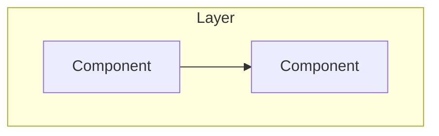

# X-Ray: Deep Repository Analysis

Perform comprehensive repository analysis with configurable depth.

## Analysis Depth

Ask user or infer from context:

| Mode | Time | Scope |
|------|------|-------|
| **Quick** | 2-5 min | Repo type, tech stack, red flags, executive summary |
| **Standard** | 10-15 min | Full discovery + key risks + scorecard |
| **Deep** | 30+ min | All stages with evidence citations + recommendations |

---

## Exploration Strategy

**Priority order for file discovery:**

```
1. Root manifests: README*, package.json, requirements.txt, go.mod, Cargo.toml, pom.xml
2. Config files: .env.example, docker-compose*, *.dockerfile, Makefile, tsconfig.json
3. CI/CD: .github/workflows/, .gitlab-ci.yml, Jenkinsfile, .circleci/
4. Entry points: main.*, index.*, app.*, server.*, cmd/
5. Source dirs: src/, lib/, pkg/, internal/, api/, services/
6. Tests: test/, tests/, *_test.*, *.spec.*
```

**Key questions to answer during exploration:**
- How do I run this locally?
- Where does execution start?
- What are the main modules/services?
- What external systems does this talk to?

---

## Stage 1: Repository Discovery

### 1.1 Classification

| Field | Options |
|-------|---------|
| **Repo Type** | backend / frontend / fullstack / infra / library / tool / monorepo / data-pipeline |
| **Domain** | payments, auth, analytics, messaging, e-commerce, healthcare, fintech, devtools, etc. |

### 1.2 Core Analysis

- **Purpose**: One sentence - what problem does this solve?
- **Responsibilities**: 3-7 main responsibilities
- **Tech Stack**: Languages, frameworks, databases, infrastructure
- **Entry Points**: How the system starts (with file paths)
- **Components**: Major modules and their roles
- **External Dependencies**: APIs, services, third-party integrations

### Stage 1 Output

```json
{
  "repo_type": "",
  "purpose": "",
  "domain": "",
  "responsibilities": [],
  "tech_stack": {
    "languages": [],
    "frameworks": [],
    "databases": [],
    "infrastructure": [],
    "key_libraries": []
  },
  "entry_points": [
    { "file": "", "description": "" }
  ],
  "components": [
    { "name": "", "role": "", "path": "" }
  ],
  "external_dependencies": [
    { "name": "", "type": "api|service|database", "purpose": "" }
  ]
}
```

---

## Stage 2: Architecture & Risk Assessment

### 2.1 Architecture Analysis

**Explain**: How components interact (data flow, dependencies, boundaries)

**Mermaid Diagram**: Generate system architecture



**Key Flows**: Trace 2-3 critical paths with steps

### 2.2 Dependency Health

| Check | Status |
|-------|--------|
| Outdated (major versions behind) | List packages |
| Known CVEs | List vulnerabilities |
| Abandoned (no updates 2+ years) | List packages |
| License issues | List conflicts |

### 2.3 Quality Scorecard

Each score requires **evidence** and **confidence level**:

```json
{
  "code_quality": {
    "score": 7,
    "confidence": "high|medium|low",
    "evidence": ["specific observations"],
    "weaknesses": []
  }
}
```

| Dimension | Criteria |
|-----------|----------|
| **Code Quality** (1-10) | Structure, modularity, separation of concerns |
| **Scalability** (1-10) | Horizontal scaling, bottlenecks, statelessness |
| **Security** (1-10) | Auth, validation, secrets, dependencies |
| **Maintainability** (1-10) | Docs, tests, change confidence |

### 2.4 Red Flags (Critical)

Issues requiring **immediate attention** before any other work:

- Exposed secrets in code or git history
- No authentication on public endpoints
- SQL injection / XSS vulnerabilities
- Outdated dependencies with known CVEs
- Hardcoded credentials
- Missing HTTPS/TLS
- No input validation on user data

**Format**: List each red flag with file path and line number when possible.

### 2.5 Risks & Anti-Patterns

**Security Risks**: Auth flaws, injection points, exposed secrets

**Scalability Issues**: Single points of failure, blocking ops, no caching

**Anti-Patterns**:
- God classes (>500 lines doing too much)
- Tight coupling / circular dependencies
- Business logic in controllers
- Missing abstraction layers
- Hardcoded config values

### Stage 2 Output

```json
{
  "architecture_explanation": "",
  "mermaid_diagram": "",
  "key_flows": [
    { "name": "", "steps": [], "files_involved": [] }
  ],
  "dependency_health": {
    "outdated": [],
    "vulnerabilities": [],
    "abandoned": []
  },
  "scorecard": {
    "code_quality": { "score": 0, "confidence": "", "evidence": [] },
    "scalability": { "score": 0, "confidence": "", "evidence": [] },
    "security": { "score": 0, "confidence": "", "evidence": [] },
    "maintainability": { "score": 0, "confidence": "", "evidence": [] }
  },
  "red_flags": [
    { "issue": "", "severity": "critical", "location": "", "details": "" }
  ],
  "risks": {
    "security": [],
    "scalability": [],
    "operational": []
  },
  "anti_patterns": [
    { "pattern": "", "location": "", "impact": "" }
  ]
}
```

---

## Stage 3: Gap Analysis & Recommendations

### 3.1 Missing Components

| Category | Expected | Status | Impact |
|----------|----------|--------|--------|
| Testing | Unit, integration, e2e | ? | High if missing |
| Documentation | README, API docs, arch docs | ? | Medium |
| CI/CD | Build, test, deploy pipelines | ? | High |
| Monitoring | Logging, metrics, alerts | ? | High for prod |
| Security | Auth, rate limiting, validation | ? | Critical |

### 3.2 Prioritized Recommendations

Rank by effort vs impact:

```json
"recommendations": [
  {
    "priority": "P0|P1|P2",
    "issue": "",
    "action": "",
    "effort": "low|medium|high",
    "impact": "critical|high|medium|low",
    "rationale": ""
  }
]
```

**Priority definitions**:
- **P0**: Security/stability risk - fix before next deploy
- **P1**: Significant improvement - fix within sprint
- **P2**: Nice to have - backlog

### 3.3 Onboarding Estimate

| Engineer Level | Time to Understand | Time to First PR |
|----------------|-------------------|------------------|
| Junior | ? | ? |
| Mid-level | ? | ? |
| Senior | ? | ? |

**Onboarding blockers**: List specific friction points (missing docs, complex setup, tribal knowledge)

---

## Executive Summary

Generate this TL;DR at the end:

```json
{
  "executive_summary": {
    "one_liner": "Brief description of what this is and its state",
    "ready_for_production": true|false,
    "overall_health": "healthy|needs-work|critical",
    "biggest_risk": "",
    "biggest_strength": "",
    "immediate_actions": ["P0 items"],
    "estimated_tech_debt_days": 0
  }
}
```

---

## Analysis Rules

1. **No hallucination** - If not clearly present, don't invent it. Say "Not found" or "Insufficient evidence"
2. **Cite evidence** - Reference specific files/lines when making claims
3. **Be critical** - Call out bad design clearly, don't soften
4. **Be specific** - "Code could be improved" is useless; specify HOW and WHERE
5. **Confidence levels** - Mark each assessment as high/medium/low confidence based on evidence

---

## Complete Output Template

```json
{
  "analysis_depth": "quick|standard|deep",
  "executive_summary": {
    "one_liner": "",
    "ready_for_production": false,
    "overall_health": "",
    "biggest_risk": "",
    "biggest_strength": "",
    "immediate_actions": []
  },
  "stage1_discovery": {
    "repo_type": "",
    "purpose": "",
    "domain": "",
    "responsibilities": [],
    "tech_stack": {},
    "entry_points": [],
    "components": [],
    "external_dependencies": []
  },
  "stage2_assessment": {
    "architecture_explanation": "",
    "mermaid_diagram": "",
    "key_flows": [],
    "dependency_health": {},
    "scorecard": {},
    "red_flags": [],
    "risks": {},
    "anti_patterns": []
  },
  "stage3_gaps": {
    "missing_components": [],
    "recommendations": [],
    "onboarding_estimate": {},
    "onboarding_blockers": []
  }
}
```

---

## Workflow Checklist

```
X-Ray Analysis Progress:
- [ ] Determined analysis depth (quick/standard/deep)
- [ ] Explored repository structure (priority files)
- [ ] Identified entry points and key files
- [ ] Classified repo type and domain
- [ ] Documented tech stack
- [ ] Mapped components and relationships
- [ ] Generated architecture diagram
- [ ] Checked dependency health
- [ ] Assessed code quality (with evidence)
- [ ] Identified RED FLAGS (critical issues)
- [ ] Identified security risks
- [ ] Identified scalability issues
- [ ] Found anti-patterns
- [ ] Listed missing components
- [ ] Created prioritized recommendations
- [ ] Estimated onboarding time
- [ ] Compiled executive summary
- [ ] Generated final JSON output
```
